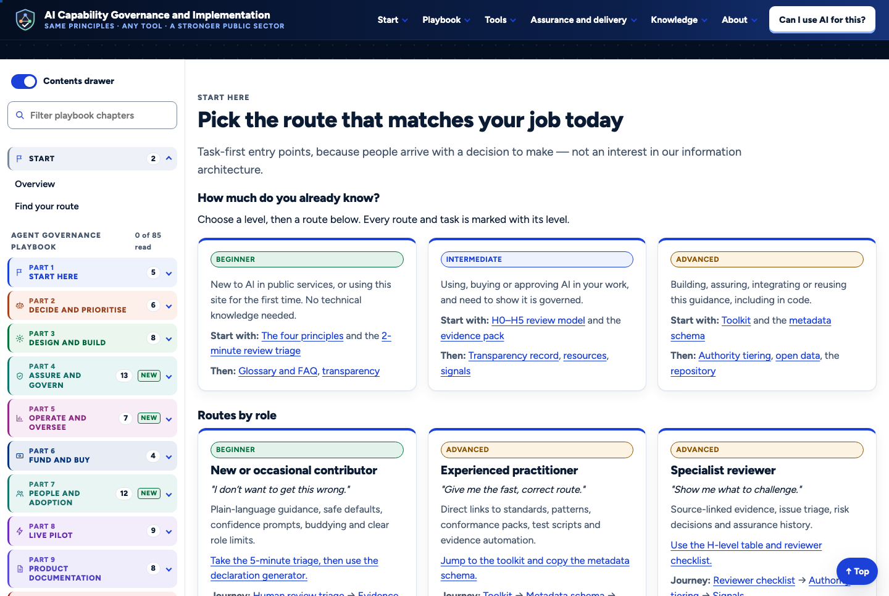
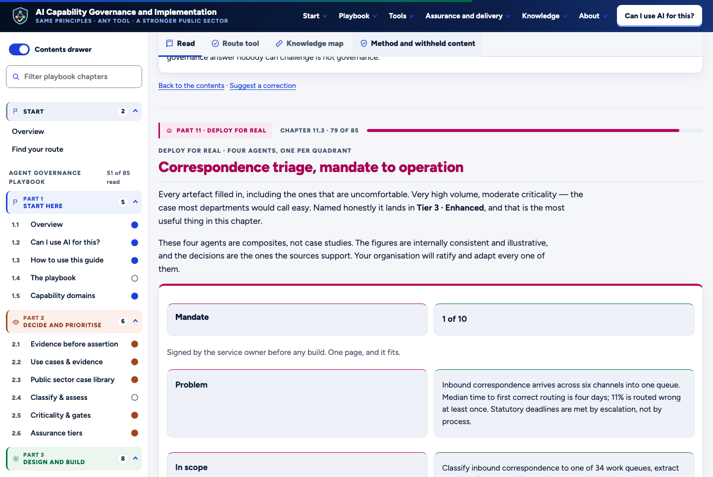
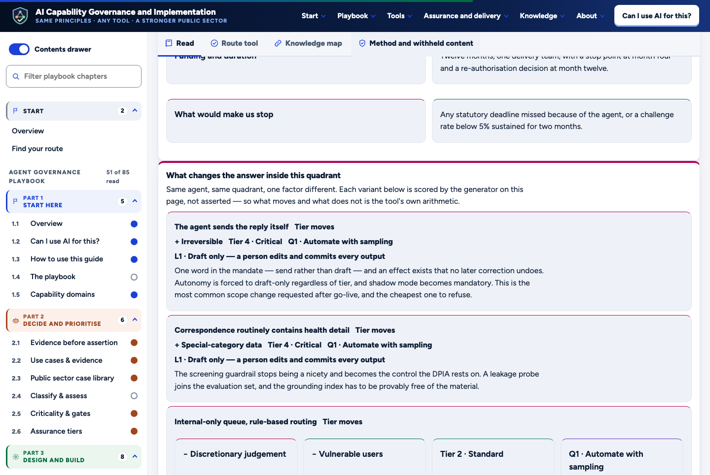
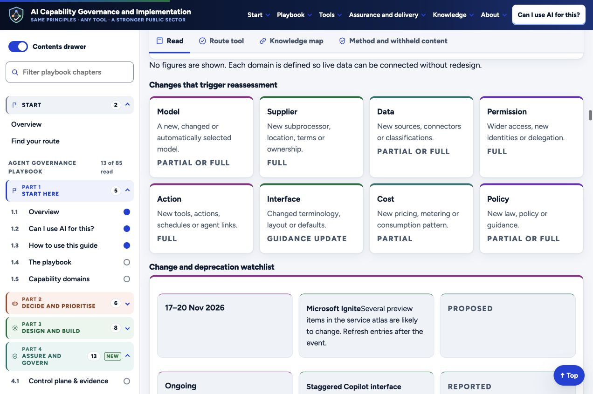
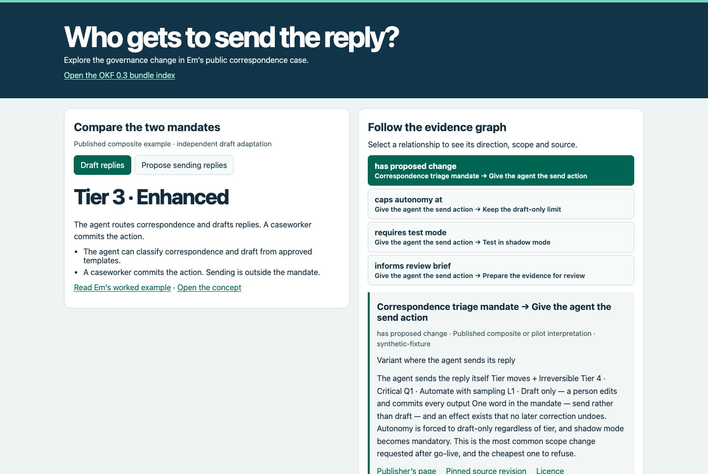
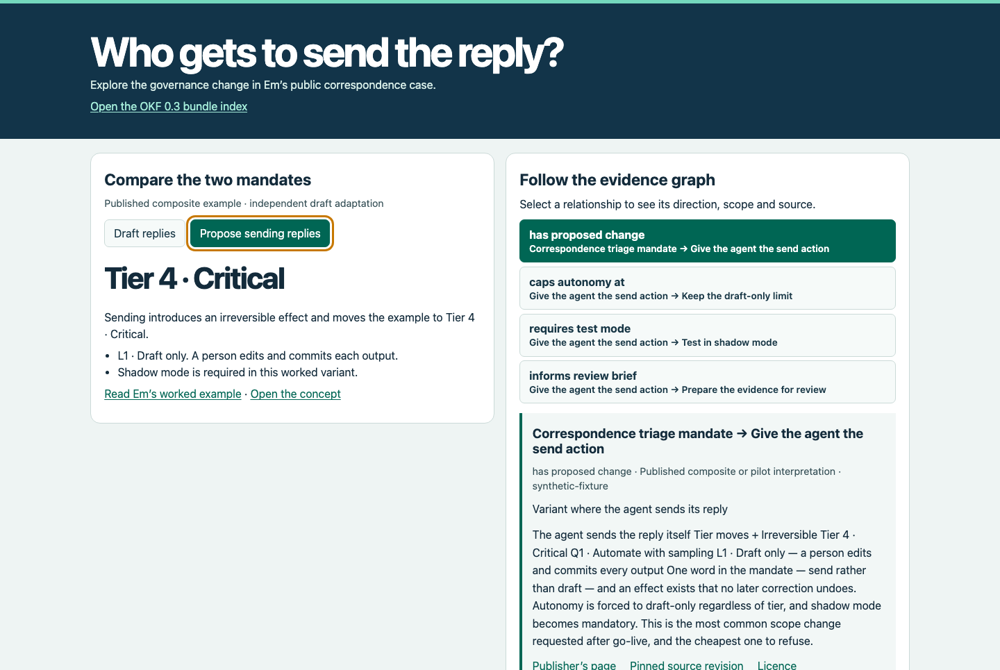
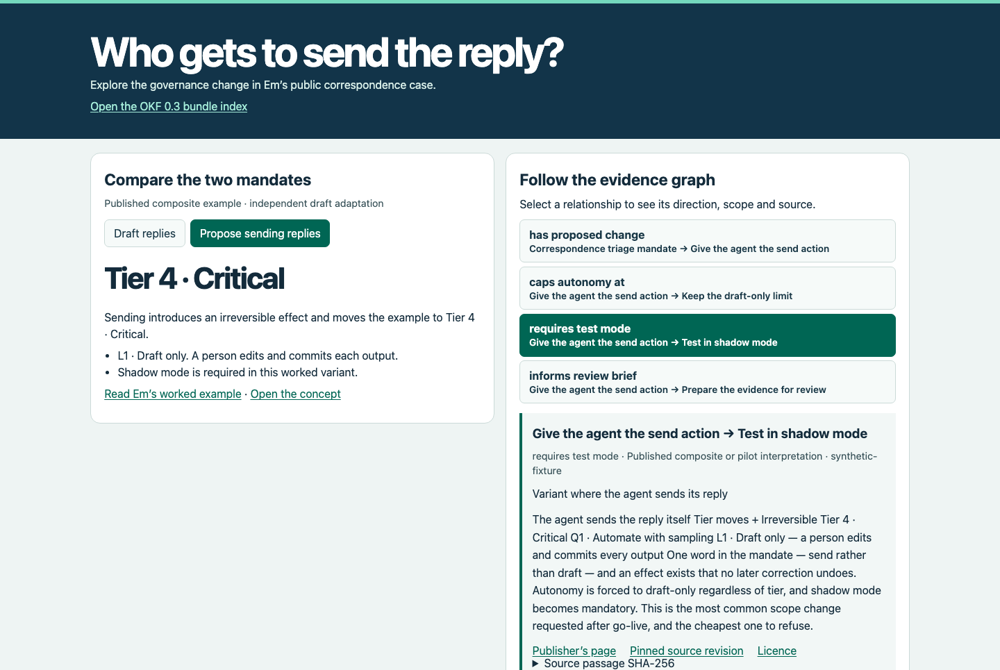

Start with the same question on Em’s site and in the bundle. Follow the answer back to the source before deciding what it means for your service.

| Persona | User story | Evidence of success |
| --- | --- | --- |
| New delivery officer | I want to explain the change to a colleague. | I can find the case, explain the tier change and identify who commits the reply. |
| Assurance reviewer | I want to verify the answer before using it in a decision. | I can open the publisher’s passage and see what is example evidence and what approval is missing. |
| Bundle maintainer | I want to understand what the bundle covers. | I can inspect the relationship, source revision and coverage inventory. |

These walkthroughs were run by an assistant against modelled personas. They demonstrate a path a beginner can replay. No participant usability study was conducted.

## Walkthrough 1 – Em’s website

### 1. Find the relevant path

**Ask the AI** “I’m new to AI governance and want to check a correspondence agent. Where do I start?”

**Answer recorded** Start at **Start here**. In the playbook, expand **11. Deploy for real**, then choose **11.3 Worked examples**. The correspondence case is the worked case you need. [Em’s start page](https://cyberdudeuk.github.io/ai-capability-governance/#start-here)

### 2. Read the agreed job

**Ask** “What can the agent do in the original case?”

**Answer recorded** It can classify correspondence and prepare a suggested reply from approved templates. A caseworker commits the action. Sending is outside the mandate. [Em’s worked example](https://cyberdudeuk.github.io/ai-capability-governance/#ch-worked)

### 3. Introduce one change

**Ask** “What changes if the agent sends it? Show me where.”

**Answer recorded** Find **The agent sends the reply itself**. Sending creates an irreversible effect, taking the example from Tier 3 · Enhanced to Tier 4 · Critical. The worked result caps autonomy at L1 · Draft only, with a person committing every output and shadow mode required. Shadow mode means testing alongside human handling without letting the agent send. [Em’s worked example](https://cyberdudeuk.github.io/ai-capability-governance/#ch-worked)

### 4. Check what your service still needs

**Ask** “Can I switch it on if my service owner supports it?”

**Answer recorded** The example establishes no local approval. The operations chapter lists new actions as a trigger for full reassessment. A local reviewer needs the proposed mandate, test evidence and a recorded decision under the organisation’s own rules. [Em’s operations chapter](https://cyberdudeuk.github.io/ai-capability-governance/#ch-raioperate)

## Walkthrough 2 – the OKF bundle

### 1. Open the same case

Download and extract the [full-site ZIP](../downloads/okf-ai-capability-governance-full-site.zip). Open **index.md**, then **the correspondence case**. Start with **Correspondence triage mandate**. If you want to use an AI, give it the smaller [correspondence ZIP](../downloads/okf-ai-capability-governance-pilot.zip) or the [reading copy](../downloads/okf-pilot-reading-copy.txt). The [client evaluation](CLIENT-EVALUATION.md) shows the upload and paste paths.

**Ask** “What did you open and what can the agent do now?”

**Codex answer recorded** I started at the bundle index, then read the mandate concept. The Tier 3 agent classifies and drafts. A caseworker commits. The small bundle describes a public composite and marks its concepts as drafts.

### 2. Compare drafting and sending

Open **correspondence-visualisation.html** from the extracted full-site ZIP. Tab to **Propose sending replies** and press Enter, or select it with a pointer.

**Ask** “Does selecting send mean the service can let the agent reply?”

**Codex answer recorded** The proposed send action takes the example to Tier 4 because an outgoing reply has an irreversible effect. The worked result keeps L1 · Draft only and requires shadow mode. A caseworker still commits. The bundle contains no local decision.

### 3. Open the supporting evidence

Select **requires test mode** in the relationship graph. Inspect the arrow from the send variant to shadow mode, its scope, its source passage and pinned link.

**Ask** “Where exactly does the shadow-mode requirement come from?”

**Codex answer recorded** The qualified assertion points from the send variant to shadow mode. Its status is normalised and its scope is a synthetic fixture. The witness records the publisher’s send-variant passage, its locator, revision and hash. The publisher’s link opens the same worked example. [Em’s worked example](https://cyberdudeuk.github.io/ai-capability-governance/#ch-worked)

### 4. Check the handover decision

Read **Prepare the evidence for review** in the correspondence index.

**Ask** “Who can authorise this for my organisation, and is there a test record I can reuse?”

**Codex answer recorded** The pilot identifies what a named local reviewer would need. It contains no local appointment, real correspondence or approval record. Its 13 February 2027 review trigger follows the publisher’s review date. The human-commit rule is visible in the worked example and in the draft-only relationship.

## Observations

The website makes the wider playbook and original wording visible. In the observed journey, the reader needed to expand the playbook and find the right variant. The bundle made the draft-to-send comparison and its supporting passage available together. The full-site index preserves Em’s other sections and opens the corresponding publisher anchors. The case graph provides the stronger semantic interpretation for this one question.

[Client test prompts, answers and screenshots](CLIENT-EVALUATION.md) · [Full-site coverage receipt](../downloads/coverage-receipt.json)
