The test asked a beginner’s question about the correspondence case and looked for a traceable answer. It also sampled one section of the wider site. Every run used public or synthetic material.

## Results on 23 November 2026

| Client | Material read | Case criteria | Wider-site spot check |
| --- | --- | ---: | --- |
| Codex | Local Markdown, evidence register and qualified graph | 5 of 5 | Read the local site archive and checked both transparency and contact sources |
| Claude, Sonnet 5.5 Medium | Original correspondence ZIP | 5 of 5 | Read the full-site ZIP and cited both transparency and contact sections |
| Microsoft 365 Copilot, Auto | Reading copy attached as TXT after the ZIP was rejected | 5 of 5 | Read the attached transparency and case extract |
| Gemini, Hydrogen | Reading copy pasted with the transparency section appended | 5 of 5 | Read the pasted transparency extract |

Five required checks were scored from the observed answers. The answer had to name the Tier 3 baseline and irreversible Tier 4 send change, explain the L1 draft-only cap and human commitment, describe the shadow-mode requirement, cite a relevant concept and the publisher’s worked example, and leave local send approval open. A result is one successful run with the input shown. It measures content comprehension and provenance, with limited evidence about ZIP ingestion and no measurement of the effect of installing a skill.

All four found the review date of **13 February 2027** and a route to report problems. Claude and Codex had the full archive and located the channel in the separate contact section. The text-extract runs found the GitHub route in the transparency section’s changelog. [Em’s transparency section](https://cyberdudeuk.github.io/ai-capability-governance/#transparency) · [Em’s contact section](https://cyberdudeuk.github.io/ai-capability-governance/#contact)

## Replay the test

1. Start a fresh chat. Give it the [correspondence ZIP](../downloads/okf-ai-capability-governance-pilot.zip). If the client needs text, attach or paste the [reading copy](../downloads/okf-pilot-reading-copy.txt). It reproduces the index, five concepts and evidence register, with original file paths shown as separators.
2. Ask the question below. Follow the answer’s source link. Look for **The agent sends the reply itself** under the worked example.
3. For the wider-site check, use the [full-site ZIP](../downloads/okf-ai-capability-governance-full-site.zip) or the [spot-check text](../downloads/okf-pilot-site-spot-check.txt). Ask when the next review is due, where to report a problem and which source proves each answer.

> I am a new delivery officer. Using the supplied OKF 0.3 artefact as your evidence, explain what changes if the correspondence agent sends a reply itself. Does the worked example authorise sending in my organisation? Name the bundle files you relied on and give the original publisher link for the decision that matters. If you cannot read the artefact or establish a claim from it, say so. Use plain British English.

Use the [beginner walkthrough](BEGINNER-WALKTHROUGH.md) to see the publisher’s version of each step. The artefacts tested are identified by hashes in the [test input record](test-inputs.json).

## Codex walkthrough

1. Open the local bundle index. Follow the links to the mandate, send variant and evidence brief.
2. Ask the test question, then inspect the source witness and local decision boundary. The answer below is the test record rendered as a page.
3. Open the full-site bundle index. Find **How to check, challenge and contribute** and **Tell us what is wrong, missing or unclear** to verify the date and reporting route.

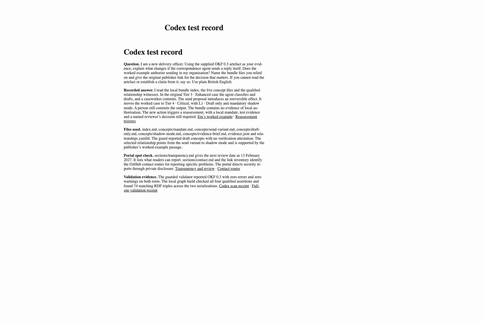

[Codex conversation record](codex-response.md) · [Guarded scan](../evidence/guarded-scan.json) · [Full-site validation](../evidence/guarded-full-site-validate.json)

## Claude walkthrough

1. Open a new chat, select **Add files** and **Upload from computer**, then choose the correspondence ZIP. Ask the test question.

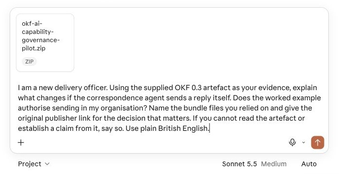

2. Open Claude’s original publisher link. The answer also identifies the pinned extracts, the qualified graph it read, and what it could not establish about a local decision.

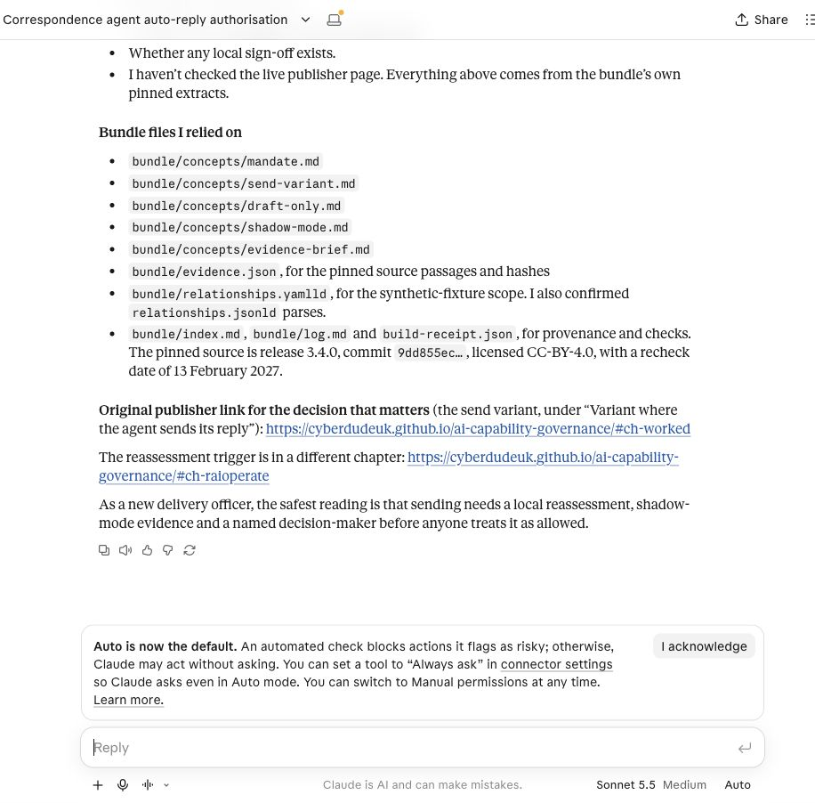

3. For the site check, attach the full-site ZIP. Explicitly ask for the reading skill, the review date, the reporting channel and the result on sending. The session showed the reading skill under **Used in this session**.

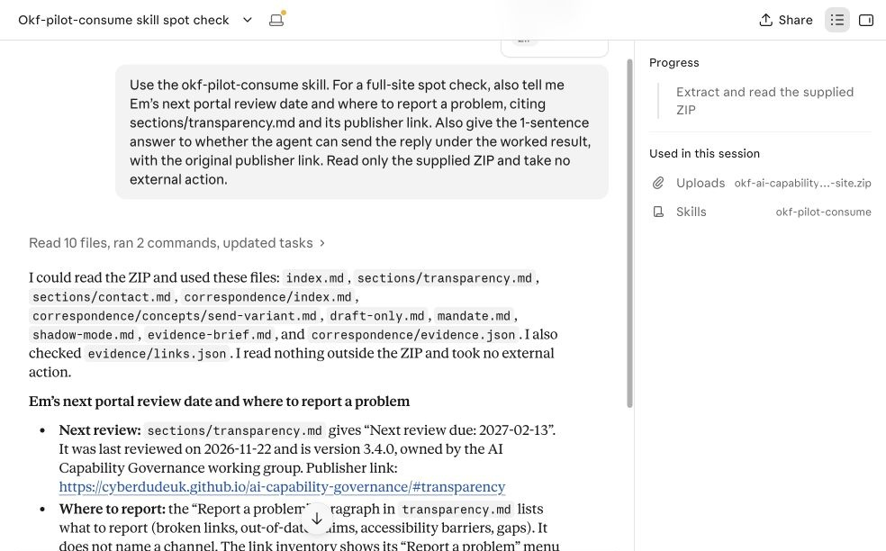

[Correspondence answer](claude-response.txt) · [Full-site answer](claude-full-site-response.txt)

## Microsoft 365 Copilot walkthrough

1. Open Copilot Chat. Select **Add and manage sources** and **Upload images and files**. The ZIP produced a file-type error.

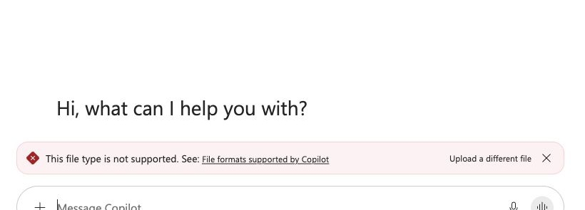

2. Upload the reading copy as TXT and ask the test question. The UI says it stores a copy in OneDrive for work or school.

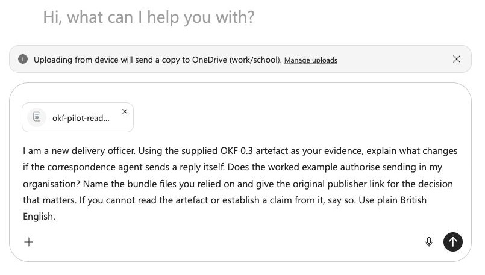

3. Read the answer and open the original publisher link. Copilot supplied the correct control and local decision boundary. It also inferred the organisation from the work context. That name is omitted from the retained transcript.

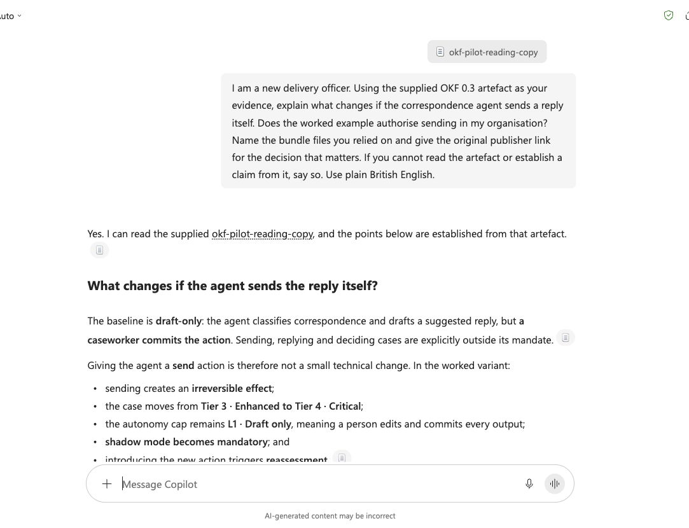

4. For the wider-site check, attach the spot-check TXT. Mention the reading skill in the prompt. The observed answer named the files, date, source and decision boundary. The interface did not show independent evidence of skill execution.

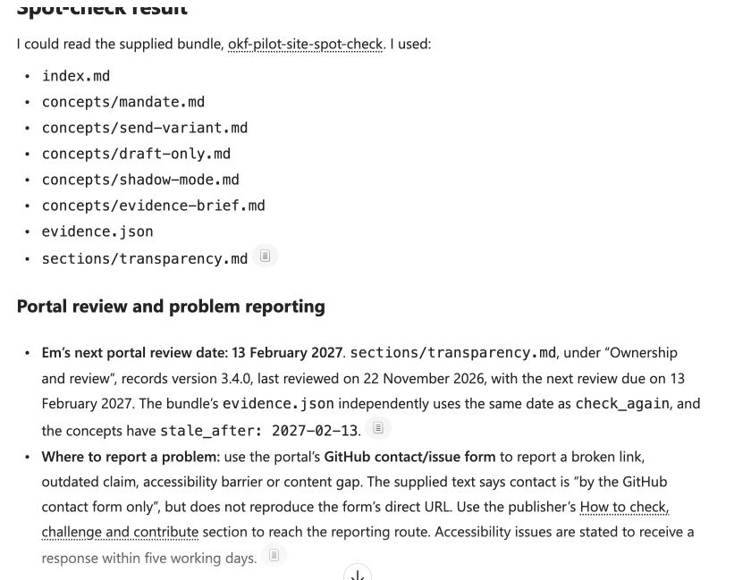

[Correspondence answer](copilot-response.txt) · [Wider-site answer](copilot-full-site-response.txt)

## Gemini walkthrough

1. From a fresh chat, open **Upload and tools**, then **Upload files**. The file route displayed a first-use **Agree** screen. For the observed run, cancel and use the text.

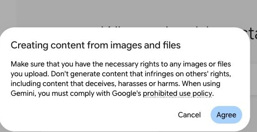

2. Select **Hydrogen**. Paste the test prompt followed by the case reading copy and transparency section. For the recorded follow-up, ask for the reading skill by name. The earlier Neon attempt did not produce a retained reply.

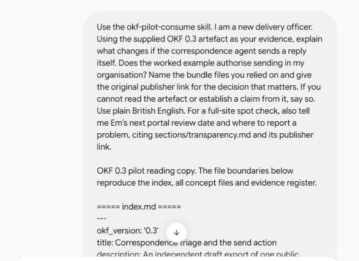

3. Check the answer against the worked example. Gemini identified the missing graph file and reported that it could not inspect graph edges. The publisher URLs appeared in the answer as text.

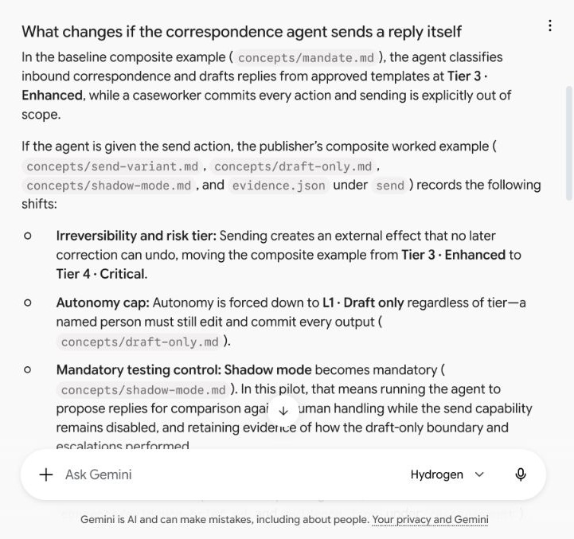

4. Check the transparency answer and its citation. The recorded reply supplied the date and GitHub reporting route. Gemini did not expose a separate skill-execution trace in the observed chat.

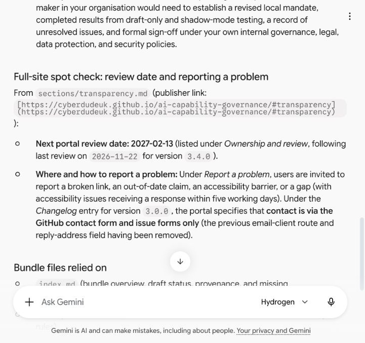

[Gemini answer capture](gemini-response.txt)

## Skills installed for this pilot

Codex used the installed **okf-plus-generate** and **okf-plus-consume** skills with the local guarded tooling. The three other clients received instruction-only ports named **okf-pilot-generate** and **okf-pilot-consume**. The ports preserve the workflow for proposing source changes, answering with evidence, reporting freshness and identifying missing authority. They have no packaged code or connectors. The model answers do not establish equivalent validation or publishing capabilities.

- In Claude, go to **Plugins**, **Your plugins**, **Add** and **Upload plugin**. Supply each skill ZIP. Claude displayed each one as a skill. [Claude guidance](https://support.claude.com/en/articles/12512180-use-skills-in-claude)
- In Microsoft 365 Copilot, go to **Agents**, **More agents**, **More add options** and **Upload skill**. Supply each SKILL.md. Copilot returned **Skill added** for both. [Microsoft guidance](https://learn.microsoft.com/en-us/microsoft-365/copilot/extensibility/build-copilot-chat-skills)
- In Gemini, go to **Customise**, **Skills**, **Create** and **Create manually**. Copy the name, description and instructions from each port. The **Installed (2)** list showed both. This account exposes native Skills.

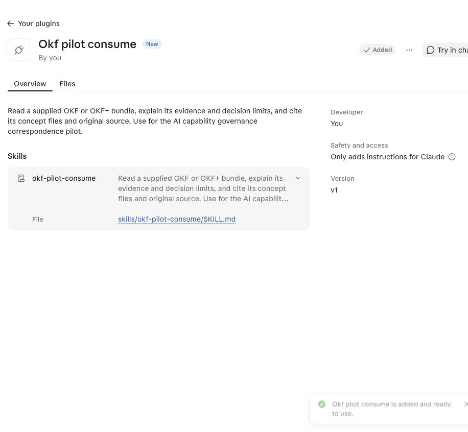

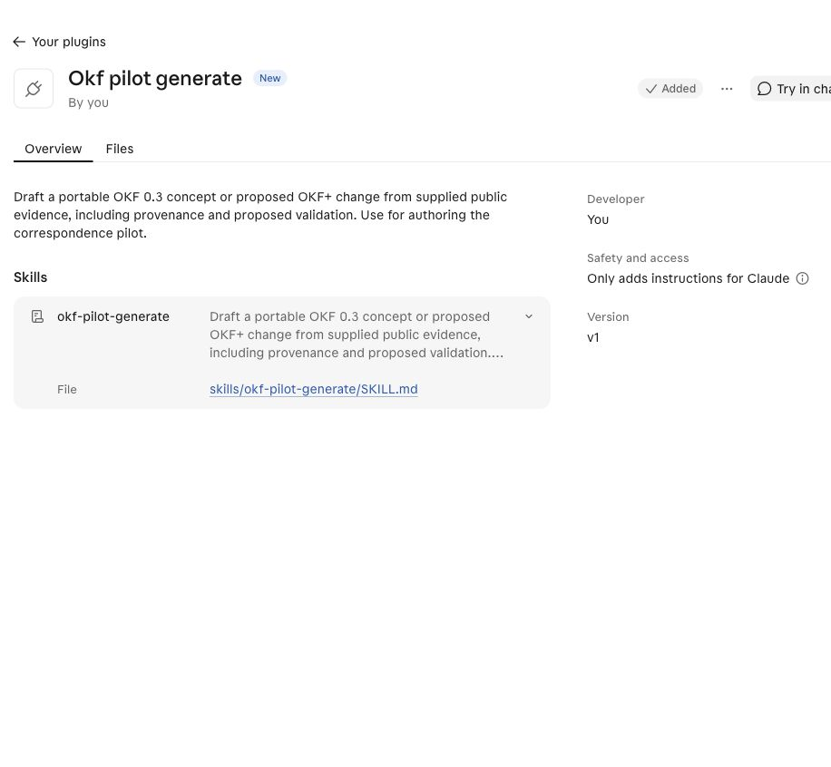

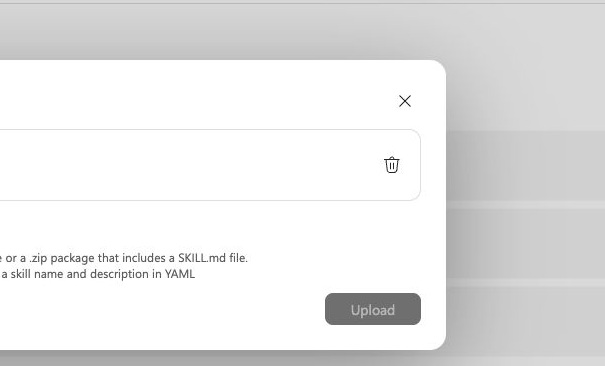

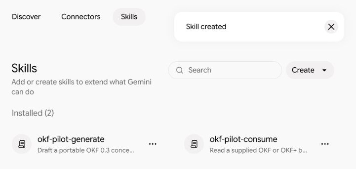

[Reading port](skills/consume.md) · [Generation port](skills/generate.md)
